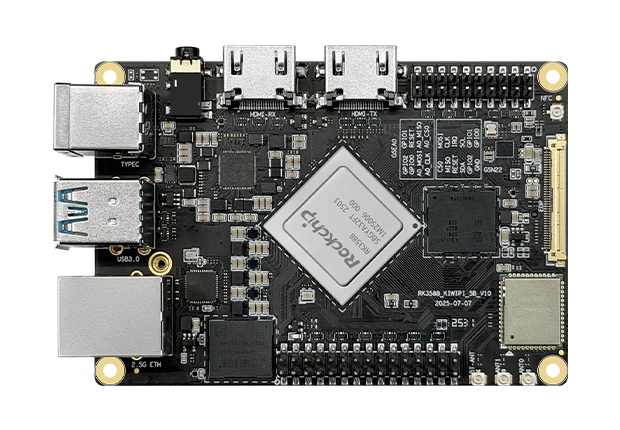
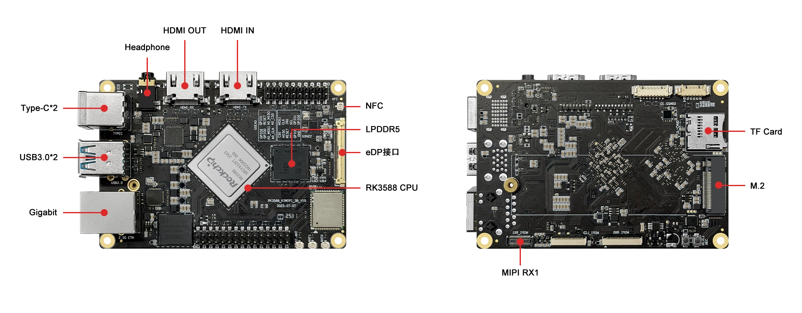

# KiwiPi 5B

Official documentation, downloads and developer resources for KiwiPi 5B, a Rockchip RK3588 single-board computer.

[KiwiPi website](https://kiwipi.com/) · [Product page](https://kiwipi.com/product/kiwi-pi-5b/) · [Documentation center](https://kiwipi.com/document-center/?dc_tab=6917.1) · [Contact KiwiPi](https://kiwipi.com/contact-us/)

## Technical configuration

| Component | Configuration |
| --- | --- |
| SoC | Rockchip RK3588, 8 nm |
| CPU | 4 × Cortex-A76 at 2.2 GHz + 4 × Cortex-A55 at 1.8 GHz |
| GPU | Arm Mali-G610 MC4 |
| NPU | Up to 6 TOPS |
| RAM | 8 GB; additional configurations listed on the product page |
| Onboard storage | 64 GB eMMC; optional 32 / 128 / 256 GB configurations |
| Storage expansion | microSD and PCIe 3.0 M.2 2280 NVMe SSD |
| Networking | Wi-Fi 6, Bluetooth 5.2 |
| Display interfaces | HDMI 2.1, DisplayPort, eDP and MIPI-DSI; see hardware manual |
| Video input | MIPI-CSI and HDMI 2.0 input |
| USB | USB-C OTG, 2 × USB 3.0 host, USB 2.0 via expansion |
| Expansion | 30-pin I/O header; consult the manual for pin assignments |
| Audio | 3.5 mm headset jack and onboard microphone |
| RTC | Rechargeable battery support |
| Power | USB-C PD/QC; follow the hardware manual for your board revision |
| Official image downloads | Android 15, Ubuntu 24.04 |

Specifications are based on the [official product page](https://kiwipi.com/product/kiwi-pi-5b/). Confirm the ordered configuration and hardware revision before choosing accessories or firmware.

## Board layout

Images: [official KiwiPi 5B product page](https://kiwipi.com/product/kiwi-pi-5b/).

## Start here

1. Identify your board model and hardware revision.
2. Read the [official manuals](https://drive.google.com/drive/folders/1yOtrqV2SbzW65fz0QdeuqpO0F1IuW298).
3. Choose a compatible image from [Downloads](docs/downloads.md).
4. Follow its firmware installation instructions. Back up storage before flashing.

## Documentation

- [Downloads and developer resources](docs/downloads.md)
- [Documentation guide](docs/documentation.md)
- [Official specifications](https://kiwipi.com/product/kiwi-pi-5b/)

## Support

[Contact KiwiPi](https://kiwipi.com/contact-us/) for help selecting resources for your board.

Third-party materials retain their authors' terms. Source archives may contain components under different licenses.
